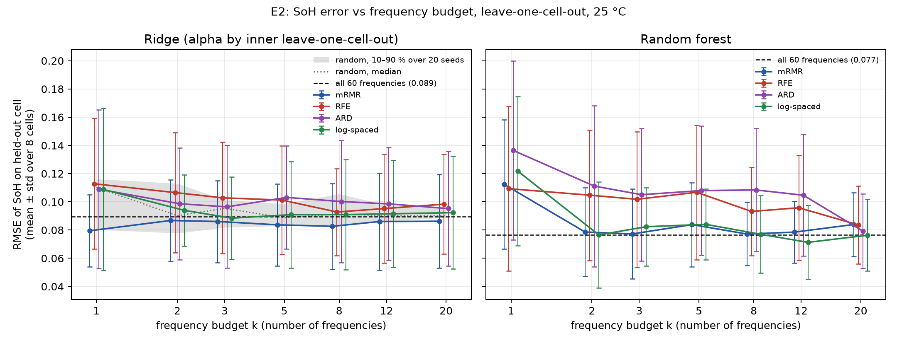
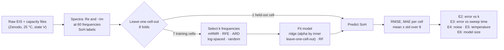

# Frugal EIS: frequency-budgeted state-of-health estimation from impedance spectra

This is a one-week student prototype. It is inspired by impedance-based battery diagnosis work at the Chair of Measurement and Sensor Technology, TU Chemnitz; it re-implements none of that work and is not affiliated with it. All numbers below come from CSVs written by the scripts in this repository.

## 1. Research question

**How few impedance frequencies are needed to estimate the state of health (SoH) of a Li-ion cell, and how do estimation error and measurement time change as the frequency budget shrinks?**

A full electrochemical impedance spectroscopy (EIS) sweep from 20 kHz down to 0.02 Hz takes minutes, and embedded battery-management hardware has little time, memory and computing power. If a few well-chosen frequencies keep most of the accuracy, SoH diagnosis becomes faster and cheaper. This project measures that trade-off on public data. It uses lightweight models and an evaluation that never tests on a cell seen in training.

## 2. Key figure



**Fig. 2.** SoH error on held-out cells against the number of frequencies k, for four selection methods; the dashed line is all 60 frequencies. In the ridge panel, the grey band is randomly chosen frequencies (10–90 % over 20 draws).
- **One frequency at about 0.04 Hz** gives ridge an RMSE of **0.080**, against **0.089 with all 60 frequencies**.
- **Beyond one frequency, the selection methods do not clearly beat evenly log-spaced or random frequencies.**
- The spread across cells (error bars) is larger than most gaps between methods.

## 3. Dataset and credits

- **Data:** Zhang, Y., Tang, Q., Zhang, Y., Wang, J., Stimming, U., Lee, A. A. (2020), [Zenodo 10.5281/zenodo.3633835](https://zenodo.org/records/3633835), CC BY 4.0. It is not committed; download instructions are in [`data/README.md`](data/README.md).
- **Cells:** commercial LiCoO₂/graphite coin cells (45 mAh), cycled at 1C charge / 2C discharge.
- **Main setup:** the **8 cells at 25 °C** with impedance at **state V** (fully charged, after a 15 min rest), giving **1,343 spectra** of **60 frequencies** from 20 kHz to 0.02 Hz. The 4 cells at 35 °C and 45 °C are used only for the temperature test (E5).
- **Label:** SoH = discharge capacity ÷ the same cell's first-cycle capacity. Each impedance cycle n is paired with the capacity of cycle n − 1, which reproduces the reference tutorial below.
- **Cross-check:** the loader was checked against the CSV of [battery-data-commons/mrs-sp22-tutorial](https://github.com/battery-data-commons/mrs-sp22-tutorial) (MIT).

## 4. Method



- **Leave-one-cell-out:** train on 7 cells, test on the 8th, for all 8. Consecutive spectra of one cell are nearly identical, so a random row split would let a model recognise the cell instead of learning aging.
- **Everything learned stays inside the training cells of each fold:** the frequency selection, the feature scaling and the ridge penalty (alpha, chosen by an inner leave-one-cell-out). Choosing alpha by leaving out single rows instead made ridge *worse than predicting the mean* (see `NOTES.md`, Day 2).
- **The unit of selection is a frequency:** keeping one keeps both its real and imaginary parts, since an instrument measures both at once.
- **Selectors:**
  - mRMR (own implementation: relevance minus mean redundancy, by correlation);
  - recursive feature elimination (RFE) with ridge;
  - GPR automatic relevance determination (ARD) length scales;
  - controls: evenly log-spaced and random frequencies.
- **Metrics:** RMSE and MAE per held-out cell, as mean ± std over cells. SoH is a fraction, so RMSE 0.08 is about 8 percentage points.
- **Tests:** 50 automated tests, including checks that no cell appears in both training and test and that selection never sees the held-out cell (`python -m pytest`).

## 5. Results

With 8 cells, differences of about 0.01 RMSE are within the noise.

### E1: full spectrum (60 frequencies)

| Model | RMSE (mean ± std) | MAE (mean ± std) | R² pooled |
| --- | --- | --- | --- |
| **Random forest** | **0.077 ± 0.026** | 0.068 ± 0.027 | 0.71 |
| Ridge (alpha by inner leave-one-cell-out) | 0.089 ± 0.038 | 0.082 ± 0.039 | 0.49 |
| Linear on R0 only (ohmic resistance, physics baseline) | 0.108 ± 0.058 | 0.090 ± 0.052 | 0.15 |
| Mean of training SoH (floor) | 0.129 ± 0.058 | 0.104 ± 0.045 | −0.04 |
| GPR with ARD (−Im only, every 4th spectrum) | 0.139 ± 0.052 | 0.120 ± 0.041 | −0.18 |
| MLP (64, 32), early stopping | 0.196 ± 0.143 | 0.164 ± 0.131 | −2.57 |

Source: [`results/e1_full_spectrum.csv`](results/e1_full_spectrum.csv).
- **The random forest is best, but it cannot extrapolate.** For cell 25C05, whose SoH falls to 0.18, its predictions stop at 0.378, just above the lowest SoH in its training data.
- **GPR and the MLP did worse than the floor in this setup.**
  - The GPR's fitted noise level collapsed to about 10⁻⁴, so away from the training spectra it falls back to the mean ([`fig1b`](results/figures/fig1b_gpr_uncertainty.png)).
  - The MLP's early stopping uses a random row split.
  - This is a finding about this setup, not about these model families.

### E2: error vs number of frequencies

Mean per-cell RMSE. "All 60" is 0.089 for ridge and 0.077 for the random forest.

| Model | Selector | k = 1 | 2 | 3 | 5 | 8 |
| --- | --- | --- | --- | --- | --- | --- |
| Ridge | **mRMR** | **0.080** | 0.087 | 0.086 | 0.084 | 0.083 |
| Ridge | log-spaced | 0.109 | 0.094 | 0.088 | 0.091 | 0.091 |
| Ridge | RFE | 0.113 | 0.107 | 0.103 | 0.101 | 0.093 |
| Ridge | ARD | 0.109 | 0.099 | 0.096 | 0.103 | 0.100 |
| Ridge | random (median of 20 draws) | 0.110 | 0.090 | 0.095 | 0.089 | 0.091 |
| Random forest | mRMR | 0.112 | 0.079 | **0.077** | 0.084 | 0.077 |
| Random forest | log-spaced | 0.122 | **0.077** | 0.082 | 0.084 | 0.077 |

Source: [`results/e2_budget_summary.csv`](results/e2_budget_summary.csv). [`results/e2_budget.csv`](results/e2_budget.csv) has the per-cell values and the frequencies chosen in each fold.
- **One or two frequencies match the full spectrum.**
- **The most informative single frequency is slow, 0.04–0.05 Hz,** in the diffusion tail of the spectrum. mRMR chose it in all 8 folds. Among random single frequencies, every one ≤ 0.13 Hz scores 0.078–0.083 and every one ≥ 0.26 Hz scores 0.099–0.117.
- **RFE and ARD are worse than random at most budgets** for ridge. They mostly pick the SEI / charge-transfer arc ([`fig5`](results/figures/fig5_selected_on_nyquist.png)).

### Other experiments (details in `NOTES.md`)

- **E3, error vs estimated sweep time** ([`fig3`](results/figures/fig3_rmse_vs_time.png)):
  - the full sweep is about **719 s**; mRMR's single 0.04 Hz frequency is about **70 s**, with no loss of accuracy;
  - mid-frequency (arc) points cost under 3 s but were less accurate with the tested selectors;
  - all times are estimates: 3 periods per frequency, no overhead.
- **E4, noise on test spectra** ([`fig4`](results/figures/fig4_noise_robustness.png)):
  - up to 1 % relative noise, the 1–2 frequency models lose nothing;
  - at 5 % they lose their advantage (ridge, 1 freq.: 0.080 → 0.098), while the full spectrum barely changes, because 60 frequencies average the noise out.
- **E6, model footprint** ([`results/e6_footprint.csv`](results/e6_footprint.csv)):
  - ridge on one frequency is **7 numbers**;
  - the random forest is about 1.5 million numbers (35 MiB) and about 60× slower per prediction on a laptop CPU.

### E5: transfer to other temperatures

Train on all 8 cells at 25 °C, then test on each 35 °C and 45 °C cell, with no temperature input and no adaptation. RMSE per test cell. Source: [`results/e5_temperature.csv`](results/e5_temperature.csv).

| Model | Frequencies | 35C01 | 35C02 | 45C01 | 45C02 | Mean of 4 | 25 °C (E2) |
| --- | --- | --- | --- | --- | --- | --- | --- |
| Mean of 25 °C SoH (floor) | 0 | 0.131 | 0.091 | 0.134 | 0.128 | 0.121 | 0.129 |
| Ridge | all 60 | 0.079 | 0.039 | **0.357** | 0.052 | 0.132 | 0.089 |
| Ridge | **1** (0.040 Hz, mRMR) | **0.041** | 0.067 | 0.139 | **0.036** | **0.071** | 0.080 |
| Random forest | all 60 | 0.155 | 0.140 | 0.138 | 0.159 | 0.148 | 0.077 |
| Random forest | 2 (20 kHz + 0.020 Hz, log-spaced) | 0.169 | 0.107 | 0.216 | 0.122 | 0.153 | 0.077 |

- **The random forest, best at 25 °C, is worse than the floor on every warmer cell.** Impedance drops with temperature, so a warm aged cell looks young, and trees cannot extrapolate.
- **Full-spectrum ridge fails on 45C01.** That cell's ohmic resistance is unusually high from the start: about 1.29 Ω, against 0.28–0.48 Ω for the other 11 cells.
- **The single 0.040 Hz frequency transfers best** (mean 0.071). With 4 test cells this is a stress test, not a general claim.

## 6. How to reproduce

Tested with Python 3.14.4 on Windows 11, CPU only.

```bash
python -m venv .venv
.venv\Scripts\activate            # Linux/macOS: source .venv/bin/activate
pip install -r requirements.txt
pip install -e .
# download and unzip the Zenodo data into data/raw/ (see data/README.md)
python -m pytest                  # 50 tests
python -m experiments.run_all     # every CSV and figure in results/, about 1 hour
python -m experiments.run_all e4  # or only the steps whose name starts with e4
```

All seeds are fixed. A full run in a fresh virtual environment reproduced every committed result:
- all figures were byte-identical;
- every CSV matched to a relative tolerance of 1e-9, except wall-clock timing columns.

```
src/frugal_eis/   data.py · features.py · models.py · evaluate.py (leave-one-cell-out) · selection.py · timing.py
experiments/      e1_* · e2_* · e3_figures · e4_* · e5_* · e6_footprint · run_all
notebooks/        01_eda.ipynb (exploratory analysis)
results/          CSVs and figures written by the scripts
tests/            pytest suite
NOTES.md          research log: every decision, problem and finding, day by day
```

## 7. Limitations

- **One dataset:** 12 coin cells of one chemistry, all cycled under the same protocol (as the dataset's own peer reviewers note), and one measurement state.
- **8 cells at 25 °C and 4 at higher temperatures**, so model and selector rankings are uncertain.
- **mRMR here is a plain greedy, correlation-based version,** not the A\*-mRMR search of Kallel & Kanoun (reference 3).
- **The "best small subset" used in E4–E6 was chosen from E2's held-out results,** which gives it a slight optimistic bias.
- **Measurement time is estimated** from the frequencies (Σ 3/f), not measured on an instrument.
- **GPR ran on −Im only, on every 4th training spectrum.** The 120-feature ARD fit did not finish one fold in over an hour on a laptop CPU.
- **The optional ONNX export was skipped:** onnxruntime has no wheel for Python 3.14.

## 8. Future work

- **Cost-aware selection:** maximise relevance per second of measurement, not per frequency. The best random pair in E3 (35.9 Hz + 17.8 Hz) scored 0.076 in an estimated 0.25 s. It was picked after the fact, so it needs a fair test with the pair fixed before seeing test cells, e.g. from Zhang et al.'s 17.8 Hz.
- **Physically meaningful features:** equivalent-circuit parameters such as the charge-transfer efficiency R_SEI / (R_SEI + R_ct) of Kallel et al. (2022), compared with selected raw frequencies.
- **Spending the time saved on repeats:** a frugal sweep could average repeated readings of its few frequencies, which addresses the noise sensitivity seen in E4.
- **More cells and conditions:** the 35 °C and 45 °C cells in training, other measurement states, and other datasets and chemistries.
- **Timing on real hardware** instead of the Σ 3/f estimate.

## 9. References

1. Zhang, Y., Tang, Q., Zhang, Y., Wang, J., Stimming, U., Lee, A. A. Identifying degradation patterns of lithium ion batteries from impedance spectroscopy using machine learning. *Nature Communications* 11, 1706 (2020). [doi:10.1038/s41467-020-15235-7](https://doi.org/10.1038/s41467-020-15235-7). Dataset: [doi:10.5281/zenodo.3633835](https://doi.org/10.5281/zenodo.3633835).
2. Kallel, A. Y., Petrychenko, V., Kanoun, O. State-of-Health of Li-Ion Battery Estimation Based on the Efficiency of the Charge Transfer Extracted from Impedance Spectra. *Applied Sciences* 12(2), 885 (2022). [doi:10.3390/app12020885](https://doi.org/10.3390/app12020885).
3. TU Chemnitz press release on fast A\*-mRMR frequency selection for impedance data (Kallel & Kanoun, SSD'26 Best Paper): <https://www.tu-chemnitz.de/tu/pressestelle/aktuell/13437/en>.
4. Peng, H., Long, F., Ding, C. Feature selection based on mutual information: criteria of max-dependency, max-relevance, and min-redundancy. *IEEE Transactions on Pattern Analysis and Machine Intelligence* 27(8), 1226–1238 (2005).
5. Guyon, I., Weston, J., Barnhill, S., Vapnik, V. Gene selection for cancer classification using support vector machines. *Machine Learning* 46, 389–422 (2002). (Recursive feature elimination.)
6. Rasmussen, C. E., Williams, C. K. I. *Gaussian Processes for Machine Learning*. MIT Press (2006). (ARD kernels.)
7. Battery Data Commons, mrs-sp22-tutorial: <https://github.com/battery-data-commons/mrs-sp22-tutorial>.

---

Author: Chedly Belkhiria, Licence in Software Engineering, Faculty of Sciences of Monastir (FSM), Tunisia.
