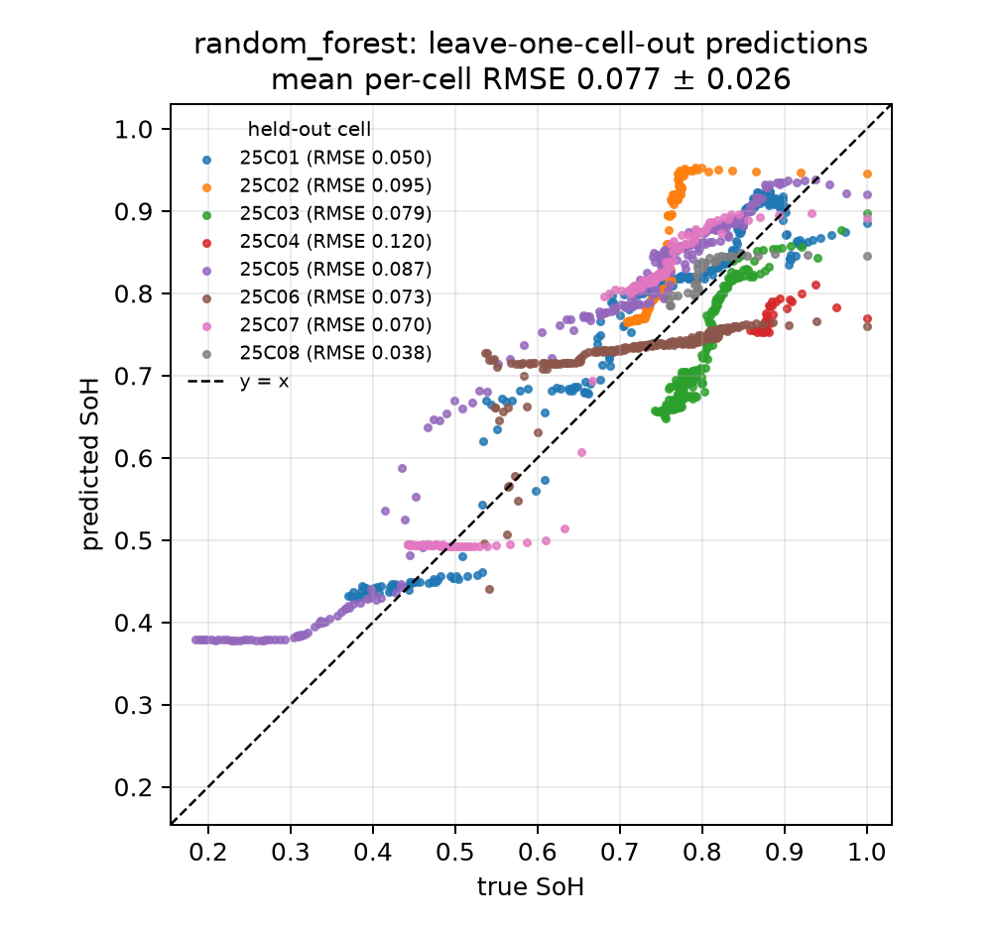

# Frugal EIS: frequency-budgeted state-of-health estimation from impedance spectra

**Research question:** how few impedance frequencies are needed to estimate the state of health (SoH) of a Li-ion cell, and how do estimation error and measurement time change as the frequency budget shrinks?

A full electrochemical impedance spectroscopy (EIS) sweep down to 0.02 Hz is slow, and embedded battery-management hardware has little time, memory and computing power. If a few well-chosen frequencies keep most of the accuracy, SoH diagnosis becomes faster and cheaper. This project studies that trade-off on public data, using lightweight models and an evaluation that never tests on a cell seen in training.

> **Status: work in progress.** Experiments E1–E5 are done: full-spectrum baselines, error vs number of frequencies, error vs estimated measurement time, noise robustness and temperature transfer. E3 and E4 are written up in `NOTES.md` so far; the final write-up comes next.

This is a student learning project, not a research claim. It is inspired by impedance-based battery diagnosis work at the Chair of Measurement and Sensor Technology, TU Chemnitz; it re-implements none of that work and is not affiliated with it.

## Data

Zhang, Y., Tang, Q., Zhang, Y., Wang, J., Stimming, U., Lee, A. A. *Identifying degradation patterns of lithium ion batteries from impedance spectroscopy using machine learning.* Nature Communications 11, 1706 (2020). [doi:10.1038/s41467-020-15235-7](https://doi.org/10.1038/s41467-020-15235-7)

- Dataset: [Zenodo 10.5281/zenodo.3633835](https://zenodo.org/records/3633835), CC BY 4.0. Download instructions are in [`data/README.md`](data/README.md); raw data is not committed.
- The cross-check CSV comes from [battery-data-commons/mrs-sp22-tutorial](https://github.com/battery-data-commons/mrs-sp22-tutorial) (MIT).
- Setup used here:
  - 8 LiCoO₂/graphite coin cells cycled at 25 °C;
  - impedance measured at **state V** (fully charged, after a 15 min rest);
  - **1,343 spectra**, each with **60 frequencies** from 20 kHz to 0.02 Hz.
- **Label:** SoH = discharge capacity ÷ the same cell's first-cycle capacity.

## Method

- **Features:** real and −imaginary parts at all 60 frequencies (120 features), or R0 only (the high-frequency real-axis intercept) for the physics baseline.
- **Evaluation: leave-one-cell-out.** Train on 7 cells, test on the held-out 8th, repeat for all 8. Consecutive spectra of one cell are nearly identical, so a random row split would let a model recognise the cell instead of learning aging.
- **Hyperparameter tuning is also done by cell.** Ridge regression with alpha chosen by leaving out single rows (`RidgeCV` default) scored *worse than predicting the mean*. Choosing alpha by leaving out training cells fixed it (see `NOTES.md`, Day 2).
- **Metrics:** RMSE and MAE per held-out cell (mean ± std over the 8 cells). R² is reported only pooled: per-cell R² is unstable for cells whose SoH barely changes.
- **Frequency selection** (E2) is fitted on the training cells of each fold only. Selectors: mRMR, recursive feature elimination (RFE) and GPR length scales (ARD), compared against evenly log-spaced and random frequencies. Keeping a frequency keeps both its real and imaginary parts.
- **Tests:** 50 automated tests cover the loader, a check that no cell appears in both training and test, the features, the models, the selectors and the sweep-time estimate (`python -m pytest`).

## Results so far: E1, full spectrum

| Model | Features | RMSE (mean ± std) | MAE (mean ± std) | R² pooled |
| --- | --- | --- | --- | --- |
| **Random forest** | 120 | **0.077 ± 0.026** | 0.068 ± 0.027 | 0.71 |
| Ridge (alpha tuned by inner leave-one-cell-out) | 120 | 0.089 ± 0.038 | 0.082 ± 0.039 | 0.49 |
| Linear on R0 only (physics baseline) | 1 (R0) | 0.108 ± 0.058 | 0.090 ± 0.052 | 0.15 |
| Mean of training SoH (reference floor) | 0 | 0.129 ± 0.058 | 0.104 ± 0.045 | -0.04 |
| GPR with ARD (−Im only, every 4th spectrum) | 60 | 0.139 ± 0.052 | 0.120 ± 0.041 | -0.18 |
| MLP (64, 32), early stopping | 120 | 0.196 ± 0.143 | 0.164 ± 0.131 | -2.57 |

Leave-one-cell-out over 8 cells at 25 °C. SoH is a fraction, so an RMSE of 0.077 means about 7.7 percentage points. Source: [`results/e1_full_spectrum.csv`](results/e1_full_spectrum.csv); per-cell values are in `results/e1_full_spectrum_per_cell.csv`.



**Observations** (8 cells only, so treat differences of about 0.01 RMSE as noise):

- **The random forest is best**, but it cannot extrapolate. For cell 25C05, whose SoH falls to 0.18, its predictions stop at 0.378, just above the lowest SoH in its training data (0.370).
- **GPR and the MLP did worse than the reference floor in this setup.**
  - The GPR's marginal-likelihood fit drove the noise level to about 10⁻⁴ or lower. Away from the training spectra its mean falls back to the training average, with a wide ±2σ band: see [`fig1b_gpr_uncertainty.png`](results/figures/fig1b_gpr_uncertainty.png). On held-out cell 25C01, 90 % of the true values lie inside ±2σ.
  - The MLP stopped after 45–96 iterations, based on a random 10 % row split for early stopping.
  - Both are tuned on training rows, the same pattern that broke ridge. This is a finding about this setup, not about these model families. Zhang et al. used a different split, all spectra and both real and imaginary parts.
- The cells age very differently, from a slow fade to sudden "knees", and the spread across held-out cells is large (std ≈ 33–73 % of the mean RMSE, depending on the model).

## Results so far: E2, error vs number of frequencies


Same leave-one-cell-out setup. Source: [`results/e2_budget.csv`](results/e2_budget.csv) (per cell, with the frequencies chosen in each fold) and `results/e2_budget_summary.csv`.

- **A few frequencies are as good as all 60.**
  - Ridge on the single frequency mRMR picks reaches RMSE 0.080, against 0.089 with all 60.
  - The random forest with 2–3 mRMR or log-spaced frequencies matches its full-spectrum 0.077.
- **The single most useful frequency is slow, about 0.04–0.05 Hz** (chosen by mRMR in all 8 folds). The random control agrees: every single frequency at or below 0.13 Hz scores 0.078–0.083, every one at 0.26 Hz or above scores 0.099–0.117.
- **Beyond one frequency, the selectors do not clearly beat a simple log-spaced grid or random choice.** RFE and ARD are worse than random at most budgets. This is a negative result, reported as such.
- The spread across held-out cells (std ≈ 0.03–0.05) is larger than most differences between selectors, so method rankings are uncertain.
- 0.04 Hz means about 25 s per period: the fewest frequencies is not the fastest measurement. E3 quantifies that.

## Results so far: E5, transfer to other temperatures

Train on all 8 cells at 25 °C, test on each 35 °C and 45 °C cell. No temperature information and no adaptation; Zhang et al. instead trained with one cell from each temperature. RMSE per test cell; source: [`results/e5_temperature.csv`](results/e5_temperature.csv).

| Model | Frequencies | 35C01 | 35C02 | 45C01 | 45C02 | Mean of 4 | 25 °C leave-one-cell-out (E2) |
| --- | --- | --- | --- | --- | --- | --- | --- |
| Mean of 25 °C SoH (floor) | 0 | 0.131 | 0.091 | 0.134 | 0.128 | 0.121 | 0.129 |
| Ridge | all 60 | 0.079 | 0.039 | **0.357** | 0.052 | 0.132 | 0.089 |
| Ridge | **1** (0.040 Hz, mRMR) | **0.041** | 0.067 | 0.139 | **0.036** | **0.071** | 0.080 |
| Random forest | all 60 | 0.155 | 0.140 | 0.138 | 0.159 | 0.148 | 0.077 |
| Random forest | 2 (20 kHz + 0.020 Hz, log-spaced) | 0.169 | 0.107 | 0.216 | 0.122 | 0.153 | 0.077 |

- **The random forest, the best model at 25 °C, fails at both new temperatures.** It is worse than the floor on every test cell and overestimates SoH by 0.10–0.16 on 3 of 4 cells. Impedance drops at higher temperature, so a warm aged cell looks like a young cell at 25 °C, and trees cannot extrapolate.
- **Full-spectrum ridge transfers to three cells but fails badly on 45C01** (RMSE 0.357). That cell has an unusually high ohmic resistance even when new (R0 ≈ 1.29 Ω, against 0.28–0.48 Ω for the other 11 cells), so a model that uses the whole spectrum reads it as heavily aged.
- **The single 0.040 Hz frequency transfers best** (mean 0.071). It beats the floor on 3 of 4 cells and roughly ties it on 45C01 (0.139 vs 0.134). One plausible reason: at that frequency −Im(Z) of new cells varies much less with temperature (0.17–0.25 Ω) than the arc or R0 do. That is an observation on 4 cells, not a general claim.
- Only 4 test cells, from 2 temperatures: treat this as a stress test, not an estimate of real-world accuracy.

## Reproduce

Tested with Python 3.14 on Windows 11; CPU only.

```bash
python -m venv .venv
.venv\Scripts\activate            # Linux/macOS: source .venv/bin/activate
pip install -r requirements.txt
pip install -e .
# download and unzip the Zenodo data into data/raw/ (see data/README.md)
python -m pytest                  # 50 tests
python -m experiments.run_all     # every CSV and figure in results/, about 1 hour
python -m experiments.run_all e4  # or only the steps whose name starts with e4
```

All seeds are fixed (`random_state=0` in the model factories; explicit seeds for the random control and the noise). Re-running reproduces the committed CSVs exactly, except columns that are wall-clock timings (`fit_s`, `latency_*`). This was checked by running everything in a fresh virtual environment built from `requirements.txt` (see `NOTES.md`, Day 6 Block 3).

## Repository layout

```
src/frugal_eis/   data.py (loading, labels) · features.py · models.py · evaluate.py (leave-one-cell-out harness)
                  selection.py (frequency selectors) · timing.py (sweep-time estimate)
experiments/      e1_partial.py · e1_full_spectrum.py · e1_figures.py · e2_frequency_budget.py · e2_figures.py · e3_figures.py · e4_noise.py · e4_figures.py · e5_selected_on_nyquist.py · e5_temperature.py · e6_footprint.py · run_all.py
notebooks/        01_eda.ipynb (exploratory analysis)
results/          CSVs and figures written by the experiment scripts
tests/            pytest suite
NOTES.md          research log: decisions, findings, open questions
```

## Limitations

- One dataset: 8 coin cells of one chemistry (LiCoO₂/graphite), one temperature, one measurement state. As the dataset's own peer reviewers note, all cells were cycled under identical conditions.
- With 8 held-out cells, model rankings are uncertain.
- GPR was run on −Im only, using every 4th training spectrum. A 120-feature ARD fit on every 2nd spectrum did not finish one fold in over an hour on a laptop CPU.
- Measurement time in E3 is *estimated* from the frequencies (3 periods each, no overhead), not measured on hardware.
- Temperature transfer (E5) is tested on 4 cells only.

## Next

- Final write-up of E3 (error vs estimated sweep time) and E4 (noise robustness) in this README.
- A fair test of cheap mid-frequency pairs (e.g. 17.8 Hz, the frequency Zhang et al. found most relevant), chosen before looking at test cells.

Author: Chedly Belkhiria, Licence in Software Engineering, Faculty of Sciences of Monastir (FSM), Tunisia.
